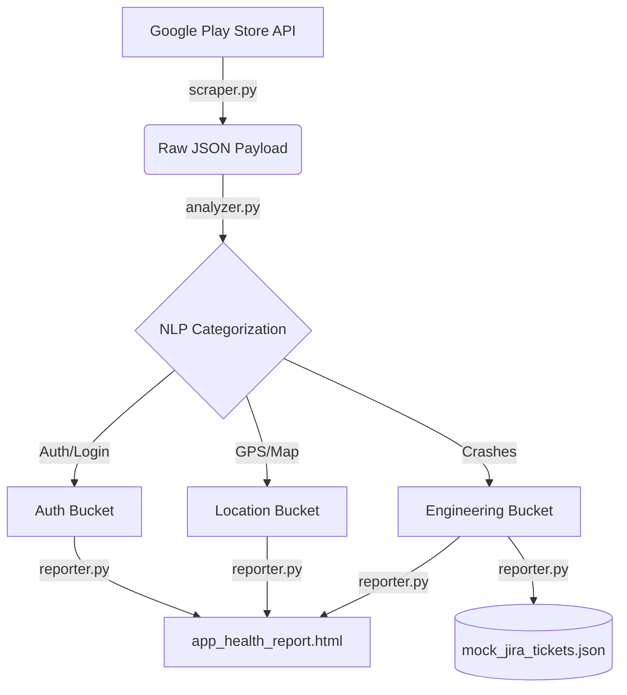

# MoveInSync Assignment: Play Store Triage Pipeline 🚀


This repository contains my technical submission for the MoveInSync Engineering Assignment. 

## 📝 The Assignment Prompt
MoveInSync provided the following scenario and prompt:

> *"How are our Play Store ratings? Work out why the ratings are where they are and tell us exactly what you would do to raise them: what to fix and what to do first. We'll act on your recommendations, so be specific enough that a product or engineering team could start the next day. This is a question we'll keep asking from time to time. It is not a one-time ask."*

---

## 💡 The Solution (Project Definition)
Instead of simply reading a few reviews and writing a subjective report, I chose to solve this problem programmatically. Because the prompt stated this is *"not a one-time ask"*, I built an **automated, scalable data pipeline** that can answer this question continuously without human intervention.

This Python-based pipeline automatically scrapes, categorizes, and routes user feedback into actionable Jira tickets for the engineering team.

### 🔍 Key Findings from the Pipeline
Running the pipeline against the latest 1,000 live Play Store reviews revealed:
1. **Critical Technical Failures:** The vast majority of 1-star reviews are not UI/UX complaints, but hard technical blockers.
2. **GPS / Location Latency:** Identified as the #1 blocker (71+ mentions of tracking lag and map freezes).
3. **Authentication (OTP):** Identified as the #2 blocker (28+ mentions of SMS gateway failures preventing login).

*(Detailed P0 and P1 sprint recommendations to fix these issues are located in the `docs/Recommendation_Memo.pdf`)*

---

## 🏗️ System Architecture & Workflow

The codebase is built using a **modular software architecture** to ensure strict separation of concerns, scalability, and easy testability. Instead of a monolithic script, the data pipeline is cleanly separated into distinct extraction, analysis, and reporting modules.



### 📂 Repository Structure
```text
📦 moveinsync-playstore-triage
 ┣ 📂 .github/workflows      # CI/CD deployment configurations
 ┃ ┗ 📜 play_store_triage.yml
 ┣ 📂 docs                   # Formal business and technical deliverables
 ┃ ┣ 📜 Methodology_and_Tools.pdf
 ┃ ┗ 📜 Recommendation_Memo.pdf
 ┣ 📂 output                 # Artifacts generated by the pipeline
 ┃ ┣ 📜 app_health_report.html
 ┃ ┗ 📜 mock_jira_tickets.json
 ┣ 📜 analyzer.py            # Core NLP & Pandas logic
 ┣ 📜 main.py                # Pipeline orchestrator
 ┣ 📜 reporter.py            # Jira JSON and HTML dashboard generators
 ┣ 📜 scraper.py             # Play Store API integration
 ┣ 📜 requirements.txt       # Python dependencies
 ┗ 📜 README.md
```

---

## ⚙️ Continuous Integration (GitHub Actions)
To fulfill the requirement that this must be a continuous process, the `.github/workflows/play_store_triage.yml` file contains the configuration to run this pipeline autonomously on a cloud runner every Sunday at midnight. 

This ensures MoveInSync's engineering team will always have up-to-date Jira tickets regarding user-reported bugs without any manual data entry.

---

## 🚀 How to Run Locally

### Prerequisites
* Python 3.10+
* Git

### Setup & Execution
1. **Clone the repository:**
   ```bash
   git clone https://github.com/shyam-medh/moveinsync-playstore-triage.git
   cd moveinsync-playstore-triage
   ```
2. **Initialize a virtual environment:**
   ```bash
   python -m venv venv
   source venv/bin/activate  # On Windows use: venv\Scripts\activate
   ```
3. **Install dependencies:**
   ```bash
   pip install -r requirements.txt
   ```
4. **Run the pipeline:**
   ```bash
   python main.py
   ```

Check the `output/` folder to view the freshly generated Jira payloads and HTML dashboards!
