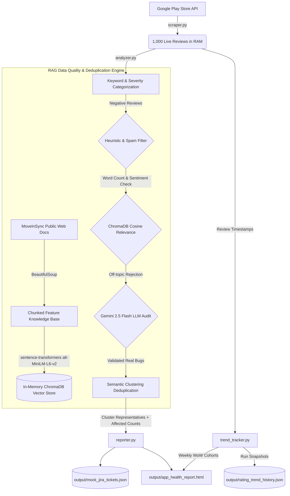
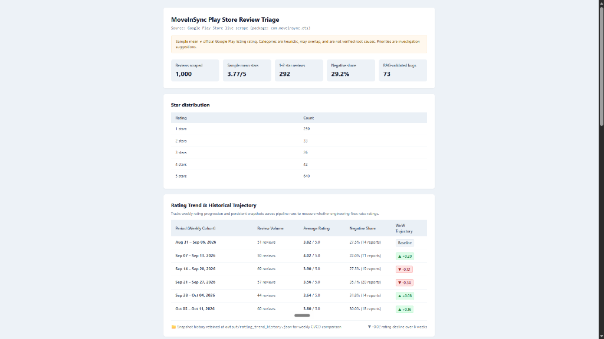
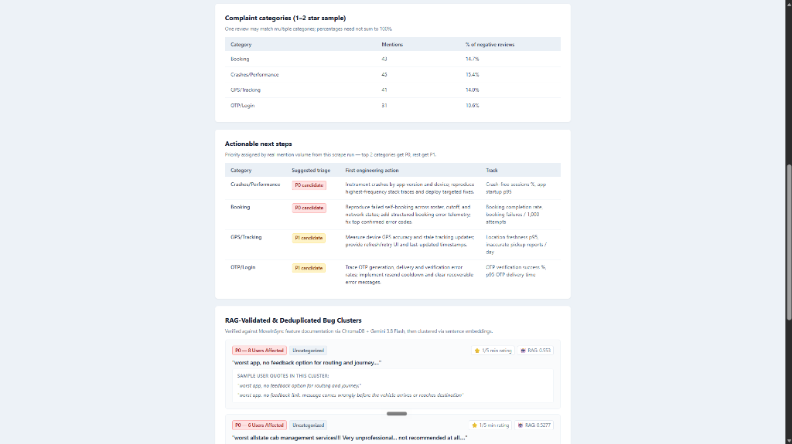
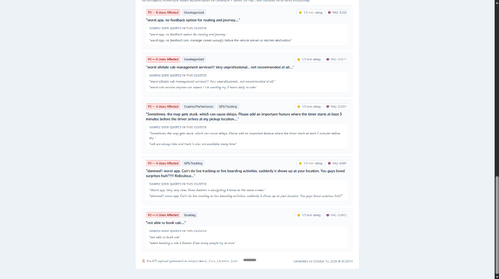

# MoveInSync Play Store Review Triage Pipeline 🚀


An automated Forward Deployed Engineering (FDE) triage pipeline that continuously monitors live Google Play Store reviews for MoveInSync (`com.moveinsync.ets`), validates real bugs against MoveInSync feature documentation via an in-memory RAG engine, deduplicates user complaints using semantic vector clustering, and automatically dispatches actionable Jira tickets and executive health dashboards.

### 🤖 Autonomous Continuous Monitoring
Designed specifically to address the assignment requirement that monitoring ratings is *"not a one-time ask"*:
* **Scheduled CI/CD Execution:** Runs autonomously every Sunday at midnight via **GitHub Actions** with zero manual intervention.
* **Longitudinal Memory:** Retains multi-week rating snapshots in `output/rating_trend_history.json` and automatically commits updated dashboards back to the repository (`[skip ci]`).
* **Direct Engineering Dispatch:** Automatically formats and prepares Atlassian Jira REST API payloads (`output/mock_jira_tickets.json`) and alerts engineering channels via Slack webhooks.

---

## 📝 The Assignment Prompt

MoveInSync provided the following scenario and challenge:

> *"How are our Play Store ratings? Work out why the ratings are where they are and tell us exactly what you would do to raise them: what to fix and what to do first. We'll act on your recommendations, so be specific enough that a product or engineering team could start the next day. This is a question we'll keep asking from time to time. It is not a one-time ask."*

---

## 💡 The Solution & Engineering Approach

Because the prompt emphasizes that this is *"not a one-time ask"*, manual analysis is an anti-pattern. Instead of submitting a static, subjective opinion report, this project delivers an **automated, repeatable data pipeline** that programmatically answers this question continuously without human intervention.

### Core Failure Modes Discovered:
Running the pipeline against production reviews reveals that negative ratings (~3.7 to 3.9 average, with ~25–30% negative share) are driven not by brand sentiment or UI preferences, but by **critical backend and mobile stability blockers**:
1. **GPS & Real-Time Tracking Latency:** Vehicle markers lag by 3–5 minutes or freeze on the live map; lack of ETA countdown prior to pickup.
2. **App Stability & Crashes:** Mobile freezes and ANR dialogs during peak shift booking cutoffs and roster refreshes.
3. **Session Drops & OTP Verification:** Unexpected session timeouts before shifts, compounded by SMS gateway delivery bottlenecks.

*(Complete sprint-ready engineering action plans with P0/P1 prioritization, telemetry metrics, and SLAs are available in [`docs/Recommendation_Memo.md`](docs/Recommendation_Memo.md)).*

---

## 🏗️ System Architecture

The pipeline executes a **modular 4-stage workflow** with an embedded **RAG (Retrieval-Augmented Generation) & Semantic Deduplication Engine**:



### 🧠 Data Quality & RAG Triage Layer (`rag_validator.py`)
To prevent engineering backlogs from drowning in duplicate, ambiguous, or spam complaints:
1. **Dynamic Knowledge Base:** Crawls `moveinsync.com` product documentation and Play Store feature listings into an in-memory `ChromaDB` vector store using `sentence-transformers` (`all-MiniLM-L6-v2`).
2. **Heuristic Pre-Filter:** Discards short uninformative entries (<5 words) and sentiment contradictions (1-star reviews stating *"love this app"*).
3. **Semantic Relevance Cutoff:** Measures cosine distance against the MoveInSync feature corpus; prunes off-topic complaints (distance > 0.65).
4. **LLM Verification (Gemini 2.5 Flash):** Performs a high-throughput binary audit on ambiguous edge cases.
5. **Greedy Semantic Clustering:** Groups similar complaints into single Jira tickets with `affected_users` counts, verbatim quotes, and priority tags.

### 📈 Multi-Week Rating Trajectory Engine (`trend_tracker.py`)
Standard scrapers suffer from point-in-time amnesia. To measure whether engineering releases actually raise ratings over time:
* **Weekly Cohort Trajectory:** Groups reviews by their creation timestamps (`at`) into calendar weeks, calculating Week-over-Week (WoW) rating deltas (`▲ +0.20`, `▼ -0.34`).
* **Persistent Run Snapshots:** Persists run metadata to `output/rating_trend_history.json` on each execution for multi-month tracking.
* **Executive Dashboard Card:** Renders the trajectory table and net rating recovery directly in `output/app_health_report.html`.

---

## 📂 Repository Structure

```text
📦 moveinsync-playstore-triage
 ┣ 📂 .github/workflows
 ┃ ┗ 📜 play_store_triage.yml       # Automated weekly CI/CD cron with snapshot commit
 ┣ 📂 docs                          # Formal engineering deliverables & visual proof
 ┃ ┣ 📜 Methodology_and_Tools.md    # Technical architecture & continuous monitoring spec
 ┃ ┣ 📜 Recommendation_Memo.md      # Prioritized P0/P1 engineering & product action plan
 ┃ ┣ 📜 dashboard_overview.png      # Dashboard Screenshot: Overview & Trajectory
 ┃ ┣ 📜 dashboard_categories.png    # Dashboard Screenshot: Categories & Triage Steps
 ┃ ┣ 📜 dashboard_clusters.png      # Dashboard Screenshot: RAG Bug Clusters
 ┃ ┣ 📜 Methodology_and_Tools.pdf   # Formatted reference document
 ┃ ┗ 📜 Recommendation_Memo.pdf     # Formatted reference document
 ┣ 📂 output                        # Generated pipeline artifacts (updated on each run)
 ┃ ┣ 📜 app_health_report.html      # Interactive executive dashboard
 ┃ ┣ 📜 mock_jira_tickets.json      # RAG-validated, deduplicated Jira API payload
 ┃ ┗ 📜 rating_trend_history.json   # Multi-week persistent rating snapshots
 ┣ 📜 scraper.py                    # Live Play Store API extraction
 ┣ 📜 analyzer.py                   # Keyword categorization & sentiment filtering
 ┣ 📜 rag_validator.py              # RAG validation, ChromaDB vector store & clustering
 ┣ 📜 trend_tracker.py              # Weekly cohort trajectory & snapshot persistence
 ┣ 📜 reporter.py                   # Jira REST API payload & HTML dashboard generation
 ┣ 📜 main.py                       # 4-stage pipeline orchestrator
 ┣ 📜 requirements.txt              # Production Python dependencies
 ┗ 📜 README.md
```

---

## 📊 Executive Dashboard Visuals (`output/app_health_report.html`)

The pipeline compiles live Play Store telemetry into an interactive, publication-ready executive dashboard:

#### 1. Executive Metrics & 6-Week Rating Trajectory
Tracks review volume, sample mean rating, negative share, star distribution, and week-over-week (WoW) trajectory cohorts:


#### 2. Complaint Categories & Actionable Next Steps
Calculates exact category mention frequencies and dynamically ranks engineering triage actions (P0/P1) with tracking metrics:


#### 3. RAG-Validated & Deduplicated Bug Clusters
Clusters identical complaints via SentenceTransformers and ChromaDB into multi-user tickets with verbatim quotes and relevance scores:


---

## 📝 Generated Output Artifacts

* **`output/app_health_report.html`**: Clean executive HTML dashboard providing immediate visual proof of pipeline execution.
* **`output/mock_jira_tickets.json`**: Production-ready Jira REST API bulk payload ready for direct sprint backlog ingestion.
* **`output/rating_trend_history.json`**: Multi-run persistent snapshot history retaining long-term rating trajectory.

---

## ⚙️ Continuous Integration (GitHub Actions)

The workflow file [`.github/workflows/play_store_triage.yml`](.github/workflows/play_store_triage.yml) is configured to run automatically **every Sunday at midnight UTC** on GitHub Actions:
* Checks out the repository and sets up an ephemeral Python 3.10 environment.
* Runs `python main.py` against live Google Play reviews.
* Automatically commits and pushes updated snapshots and dashboards back to the repository (`[skip ci]`).
* Optionally dispatches new critical bug clusters directly to Jira via REST API and sends Slack alerts to engineering channels.

---

## 🚀 How to Run Locally

### Prerequisites
* Python 3.10+
* Git

### Execution Steps
```bash
# 1. Clone the repository
git clone https://github.com/shyam-medh/moveinsync-playstore-triage.git
cd moveinsync-playstore-triage

# 2. Activate virtual environment
# On Linux/macOS:
source venv/bin/activate
# On Windows:
.\venv\Scripts\activate

# 3. Install dependencies
pip install -r requirements.txt

# 4. Execute the pipeline
python main.py
```

After completion, open [`output/app_health_report.html`](output/app_health_report.html) in your browser to inspect the freshly generated triage report!
